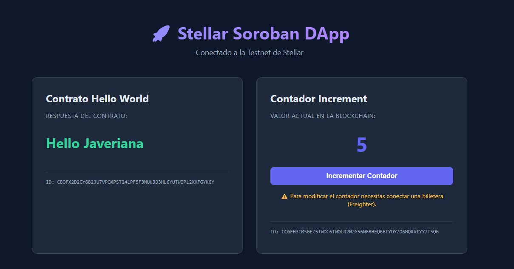

# Getting Started

Evidencia de que el equipo instaló el entorno y desplegó su primer contrato en testnet.
Guía que seguimos: [Getting Started de contratos](https://developers.stellar.org/docs/build/smart-contracts/getting-started).

| Dato | Valor |
|---|---|
| Lo hizo | Andres Chanchi (Técnico) |
| Sistema operativo | WSL2 (Debian) |
| Fecha | 2026-10-28 |

## 1. Entorno

Salida de los comandos, copiada de la terminal como texto (no como captura).

```sh
$ rustc --version
rustc 1.99.1 (58cf8f9c3 2026-10-13)

$ stellar --version
stellar 28.1.0 (c0f4d0da891bbf214c08b8c5035ae6db80e9a3bd)
stellar-xdr 28.0.0 (d0f1330e43c3a2c0c616da30698b24140d4eea72)
xdr (9c9c145953e80990d6ff1ae3a6a973a0ce6d0694)

$ bun --version
1.4.2
```

## 2. Mínimo · paso 2: hello_world en testnet

| Dato | Valor |
|---|---|
| Red | Testnet |
| Cuenta que desplegó | `abba-emuna` · `GBJEYMIQBU36AOXOITLUDUNSLH4272A5WIGCRT5ERVHFPSAXAASNM4CB` |
| Contract ID | `CBOFX2D2CY6B2JU7VPOXP5T24LPF5F3MUK3D3HL6YUTWIPL2XXFGYKGY` |
| Enlace en stellar.expert | [Ver Contrato](https://stellar.expert/explorer/testnet/contract/CBOFX2D2CY6B2JU7VPOXP5T24LPF5F3MUK3D3HL6YUTWIPL2XXFGYKGY) |
| Hash del invoke de `hello` | `7d2254b3d7a208a0b0c87c105131175cf731bec36f09d4816be18567552ef8f1` |
| Resultado del invoke | `["Hello","Javeriana"]` |

## 3. Reto · paso 5: frontend de Hello World

Los pasos 3 y 4 desplegaron el contrato `increment` y el paso 5 conectó un frontend en Astro (gestionado con Bun) al contrato `hello_world`.

| Dato | Valor |
|---|---|
| Contract ID de `increment` | `CCGEH3IM5GEZ5IWDC6TWOLR2NZG56NGBHEQ66TYDYZO6MQRAIYY7T5QG` |
| Enlace en stellar.expert | [Ver Contrato Increment](https://stellar.expert/explorer/testnet/contract/CCGEH3IM5GEZ5IWDC6TWOLR2NZG56NGBHEQ66TYDYZO6MQRAIYY7T5QG) |
| Comando con el que corre el frontend | `bun run dev` (dentro de la carpeta `frontend`) |

Captura del frontend:



## 4. Comandos que usamos

```sh
# Crear el proyecto y compilar
stellar contract init hello-jave
cd hello-jave
stellar contract build

# Cuenta de testnet con fondos de Friendbot
stellar keys generate abba-emuna --network testnet --fund

# Desplegar Hello World: devuelve el Contract ID (empieza por C)
stellar contract deploy \
  --wasm target/wasm32v1-none/release/hello_world.wasm \
  --source-account abba-emuna --network testnet --alias hello_world

# Invocar hello y enviar la transacción para obtener el hash
stellar contract invoke --id hello_world --source-account abba-emuna \
  --network testnet --send=yes -- hello --to Javeriana
```

> 💡 **¿Por qué `--send=yes`?** `hello` solo lee, no escribe nada. Sin esa opción la CLI simula la llamada, te muestra el resultado y **no** envía transacción, así que no hay hash que pegar.

Comandos usados para el reto (Pasos 3 a 5):

```sh
# 1. Crear y compilar contrato increment
stellar contract init . --name increment
stellar contract build
cargo test

# 2. Subir el Wasm a la red y obtener el Wasm Hash
stellar contract upload \
  --network testnet \
  --source-account abba-emuna \
  --wasm target/wasm32v1-none/release/increment.wasm

# 3. Desplegar el contrato increment usando el Wasm Hash
stellar contract deploy \
  --wasm-hash e52576618ac07e7ea4be42d811848345e830e5ff738c05aac307fe4ae1ea0bd2 \
  --source-account abba-emuna \
  --network testnet \
  --alias increment

# 4. Generar bindings de TypeScript para el frontend
stellar contract bindings typescript \
  --network testnet \
  --contract-id hello_world \
  --output-dir frontend/packages/hello_world

# 5. Instalar dependencias y correr el frontend
cd frontend
bun install
bun run dev
```

## 5. Revisión antes del PR

Mínimo:

- [x] Las versiones están pegadas como texto, con el comando arriba de cada una.
- [x] El Contract ID empieza por `C` y el enlace de stellar.expert abre el contrato.
- [x] El hash tiene 64 caracteres y aparece en stellar.expert al buscarlo.
- [x] No hay llaves secretas (`S…`) en ningún archivo.

Reto (opcional):

- [x] El Contract ID de `increment` abre en stellar.expert.
- [x] `frontend.png` está en esta carpeta y se ve en la vista previa de GitHub.

